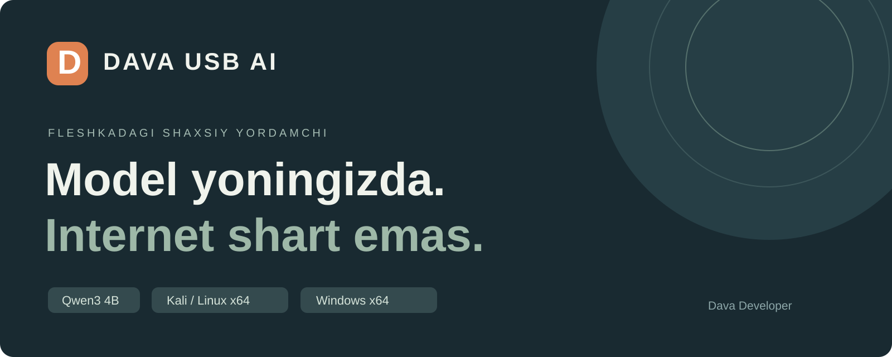
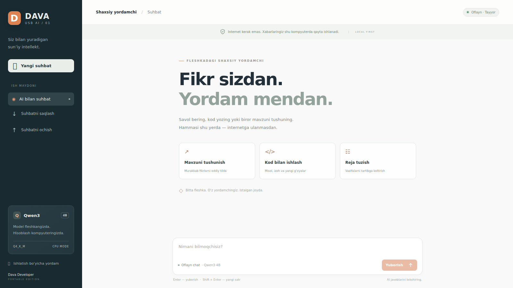
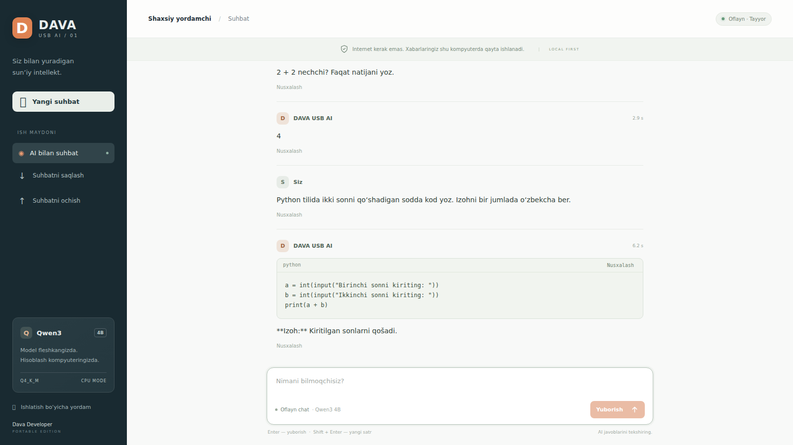

# DAVA USB AI

Fleshkadan ishlaydigan shaxsiy oflayn AI chat. O‘zbekcha interfeys, haqiqiy Qwen3 4B modeli, Kali/Linux va Windows boshlash fayllari.

**[To‘liq tayyor paketni yuklash → Releases](https://github.com/Muqimovdavronbek/dava-usb-ai/releases)**

Model va dastur to‘liq release paketida mavjud. GitHub’dagi **Code → Download ZIP** faqat dastur kodlarini yuklaydi; katta modelni o‘z ichiga olmaydi.

## Video va rasmlar

[O‘zbekcha ovozli videoqo‘llanma](docs/video/Dava_USB_AI_Video_Qollanma.mp4) · [Qadamlar va manzillar](docs/QUICKSTART_UZ.md) · [Subtitrlar](docs/video/Dava_USB_AI_Qollanma.srt)

Videoda rasmiy saytlar, GitHub yuklama sahifasi, buyruqlar va haqiqiy modeldan olingan javoblar ko‘rsatiladi. Ovoz sun’iy. Windows bo‘limi yo‘riqnoma sifatida berilgan.

## Boshlash

1. Releases sahifasidan `Dava_USB_AI_Yigish.zip` va `.001` dan `.005` gacha barcha 5 qismni kompyuterda bir papkaga yuklang.
2. Yig‘ish ZIPini oching. Kali’da `bash TAYYORLASH_KALI.sh`, Windows’da `TAYYORLASH_WINDOWS.cmd`ni bajaring.
3. Chiqqan **Dava_USB_AI** papkasini butunligicha fleshkaga ko‘chiring.
4. Kali’da `bash BOSHLASH_KALI.sh`, Windows’da `BOSHLASH_WINDOWS.cmd`ni ishga tushiring.
5. Terminalda `TAYYOR` yozuvi chiqqach, chat brauzerda ochiladi. Odatdagi manzil: `http://127.0.0.1:8765/`.

Qismlarning nazorat summalari avtomatik tekshiriladi. Qo‘shimcha model, API kaliti, obuna yoki dastur o‘rnatish kerak emas. Kali’dagi Python 3, Windows’dagi PowerShell ishlatiladi.

## Talablar

| Narsa | Talab |
|---|---|
| Tizim | Intel/AMD x64, Kali/Linux yoki Windows 10/11 |
| Operativ xotira | 8 GB yoki ko‘proq tavsiya, taxminan 4 GB bo‘sh RAM |
| Fleshka | Tayyor papka uchun kamida 3 GB bo‘sh joy, bo‘sh 4 GB fleshkaga sig‘adi |
| Yig‘ish joyi | Kompyuter diskida qo‘shimcha 5.1 GB |
| Brauzer | Yangiroq Firefox, Chrome yoki Edge |

## Suhbat va maxfiylik

Model shu kompyuterning CPU’sida hisoblaydi. Server faqat `127.0.0.1`ga ulanadi. Chat internetga so‘rov yubormaydi. Suhbatlar joriy brauzer xotirasida turadi; boshqa kompyuterga ko‘chirish uchun JSON eksport/import tugmalaridan foydalaning.

Model faqat matnni tushunadi. Internetdan qidirmaydi, rasm va ovozni tahlil qilmaydi. AI javoblarini tekshiring. Tugatgach terminalda `Ctrl+C` bosing, so‘ng fleshkani xavfsiz ajrating.

## Sinov

Linux x64 muhitida haqiqiy model bilan ishga tushirish, o‘zbekcha javob, oqimli chiqarish, suhbat eksport/importi va to‘xtatish tekshirildi. Windows boshlash fayllari tayyorlangan; Windowsning o‘zida sinov bajarilmagan.

## Manbalar va litsenziya

- [Mozilla llamafile 0.10.6](https://github.com/mozilla-ai/llamafile/releases/tag/0.10.6)
- [Rasmiy Qwen3-4B-GGUF](https://huggingface.co/Qwen/Qwen3-4B-GGUF)
- Model commit: `bc640142c66e1fdd12af0bd68f40445458f3869b`
- Yangi interfeys va boshlash fayllari: MIT, Dava Developer.
- Asosiy dvigatel, model va bog‘liqliklar o‘z litsenziyalarini saqlaydi: [licenses](licenses).

Release GitHub Actions orqali rasmiy manbalardan nazorat summalarini tekshirgan holda quriladi. Model repo tarixiga qo‘shilmaydi; barcha model baytlari release fayllarida mavjud.
