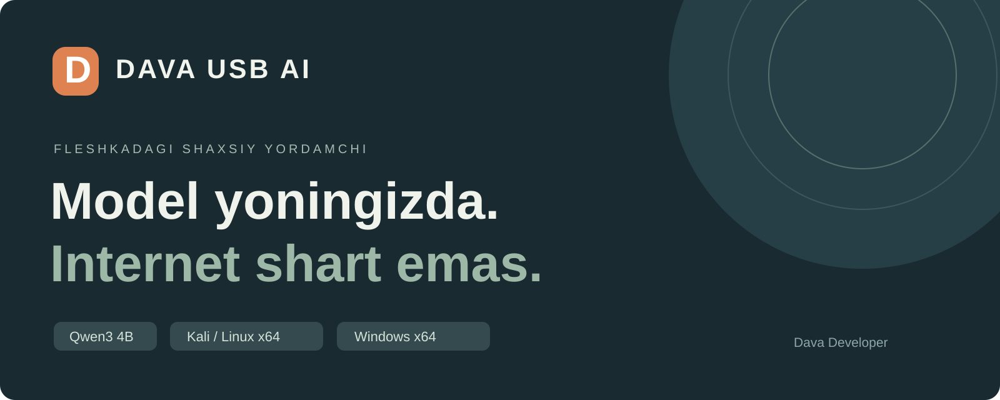
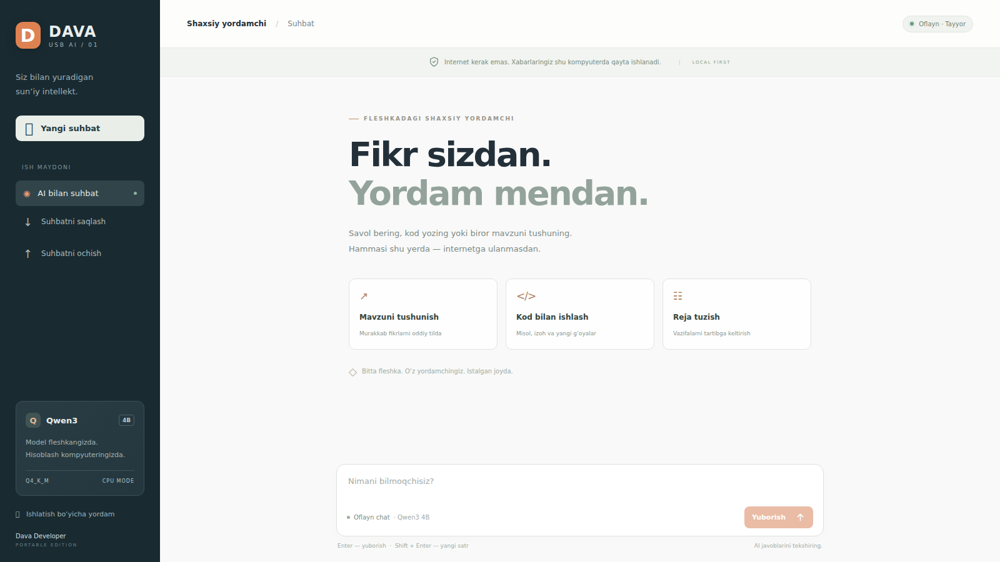
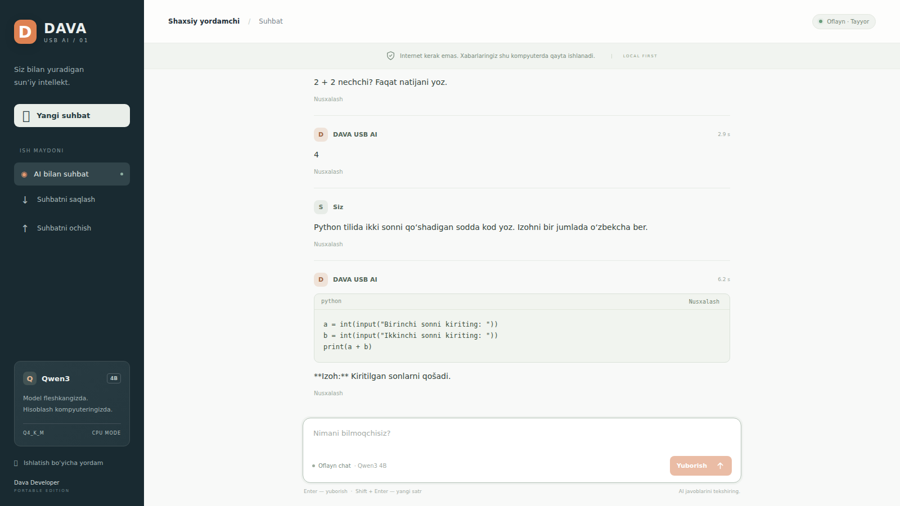

# DAVA USB AI

**A local text assistant designed to travel with your USB drive.**

[Download the complete package](https://github.com/Muqimovdavronbek/dava-usb-ai/releases) · [Quick start](docs/QUICKSTART.md)

## Features

- Local Qwen3 4B text generation on the computer's CPU.
- Launch scripts for Linux x64 and Windows 10/11 x64.
- Streaming responses, stop control and conversation reset.
- JSON conversation export/import for moving between computers.
- Loopback-only server and no cloud API requirement during use.

## Download and start

1. Download `Dava_USB_AI_Yigish.zip` and all five `.001`–`.005` parts from Releases into one directory.
2. Extract the assembly ZIP.
3. Run `bash TAYYORLASH_KALI.sh` on Linux or `TAYYORLASH_WINDOWS.cmd` on Windows.
4. Copy the complete generated `Dava_USB_AI` directory to the USB drive.
5. Run `bash BOSHLASH_KALI.sh` or `BOSHLASH_WINDOWS.cmd`.
6. Wait for the ready message and use the browser address printed by the launcher, normally `http://127.0.0.1:8765/`.

The complete model is supplied in release assets. **Code → Download ZIP** contains the source, not the model.

## Requirements

| Component | Requirement |
| --- | --- |
| Architecture | Intel/AMD x64 |
| Memory | 8 GB recommended; roughly 4 GB free for the model |
| USB space | At least 3 GB free |
| Assembly space | Approximately 5.1 GB on the computer |
| Browser | A recent Firefox, Chrome or Edge |

## Usage and storage

Type a message and press Enter; Shift+Enter inserts a new line. Keep the launcher terminal open. Export conversations to JSON before moving to another computer; browser storage is not automatically written to the USB drive.

This model processes text only. It does not search the web or analyze audio/images. Stop the launcher with `Ctrl+C` before removing the drive.

## Validation and license

Earlier live model checks were performed on Linux x64. Windows launchers were prepared but were not validated on native Windows in that environment.

Original interface and launch scripts: MIT. Engine, model and dependencies retain their existing [license notices](licenses).
